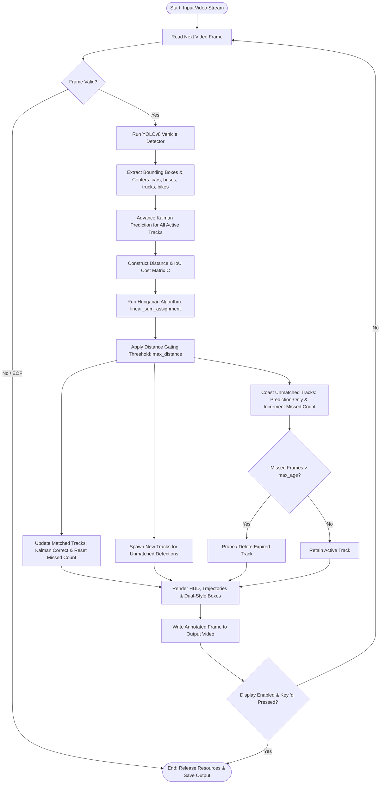

# SARDAR VALLABHBHAI NATIONAL INSTITUTE OF TECHNOLOGY, SURAT
## Department of Computer Science and Engineering
### CS359: Artificial Intelligence for Robotics — Laboratory Record

---

| **Academic Detail** | **Particulars** |
| :--- | :--- |
| **Course Code & Title** | CS359 — Artificial Intelligence for Robotics |
| **Lab Assignment No.** | 10 |
| **Assignment Title** | Multi-Vehicle Tracking Using Kalman Filter & Data Association |
| **Academic Term** | Autumn Semester 2026 / E3S1 |
| **Student Roll Number** | U24CS118 |
| **Operating System** | Windows 11 / Linux Compatible |
| **Programming Language** | Python 3.13 |

---

## 1. Aim
To design, implement, and evaluate a general-purpose Multi-Vehicle Tracking System using a 2D Constant-Velocity Kalman Filter and Hungarian Data Association that accepts arbitrary traffic video feeds, maintains persistent vehicle identities, handles temporary missing detections via coasting, and produces annotated output videos with trajectory histories.

---

## 2. Hardware and Software Requirements

### Hardware Requirements
- **Processor:** Intel Core i5/i7 (8th Gen or higher) / AMD Ryzen 5 or Apple Silicon
- **RAM:** Minimum 8 GB (16 GB recommended)
- **GPU:** Optional (CUDA-compatible GPU accelerates inference, but CPU execution is fully supported)
- **Storage:** Minimum 1 GB free space for packages, models, and video caches

### Software Requirements
- **Operating System:** Microsoft Windows 10/11 or Ubuntu Linux 20.04/22.04 LTS
- **Python Runtime:** Python 3.9+ (tested on Python 3.13.1)
- **Core Libraries:**
  - `opencv-python` / `opencv-contrib-python` (v5.0.0 / v4.13.0) — Video decoding, drawing, cv2.KalmanFilter
  - `ultralytics` (v8.4.187) — Pretrained YOLOv8 object detector
  - `numpy` (v2.2.5) — Vectorized linear algebra and matrix operations
  - `scipy` (v1.17.1) — Hungarian linear sum assignment algorithm
  - `torch` & `torchvision` (v2.13.0) — Deep learning tensor runtime
  - `pytest` (v9.1.1) — Automated testing framework

---

## 3. Theoretical Background & Mathematical Formulation

### 3.1 State Representation & Kinematic Equations
Each vehicle track is modeled as an independent point-mass moving with approximately constant velocity in a 2D Cartesian plane:

$$\mathbf{x}_k = \begin{bmatrix} x_k \\ y_k \\ v_{x, k} \\ v_{y, k} \end{bmatrix} \in \mathbb{R}^4$$

Where:
- $x_k, y_k$: Coordinates of the bounding box centroid at time step $k$.
- $v_{x, k}, v_{y, k}$: Velocity along horizontal and vertical image axes in pixels per frame.

Under a constant-velocity assumption with sampling interval $\Delta t = 1.0$:

$$x_k = x_{k-1} + v_{x, k-1}\Delta t + w_{x, k-1}$$
$$y_k = y_{k-1} + v_{y, k-1}\Delta t + w_{y, k-1}$$
$$v_{x, k} = v_{x, k-1} + w_{vx, k-1}$$
$$v_{y, k} = v_{y, k-1} + w_{vy, k-1}$$

### 3.2 State Transition Matrix ($F$)
$$F = \begin{bmatrix} 1 & 0 & \Delta t & 0 \\ 0 & 1 & 0 & \Delta t \\ 0 & 0 & 1 & 0 \\ 0 & 0 & 0 & 1 \end{bmatrix}$$

### 3.3 Observation Model & Measurement Matrix ($H$)
The deep learning detector (YOLOv8) outputs bounding boxes $[x_1, y_1, x_2, y_2]$, yielding the observation vector:

$$\mathbf{z}_k = \begin{bmatrix} z_{x, k} \\ z_{y, k} \end{bmatrix} = \begin{bmatrix} \frac{x_1 + x_2}{2} \\ \frac{y_1 + y_2}{2} \end{bmatrix}$$

The linear measurement relationship is:
$$\mathbf{z}_k = H \mathbf{x}_k + \mathbf{v}_k, \quad \text{where } H = \begin{bmatrix} 1 & 0 & 0 & 0 \\ 0 & 1 & 0 & 0 \end{bmatrix}$$

### 3.4 Noise Covariances
- **Process Noise Covariance ($Q$):**
  $$Q = \text{diag}([1.0, 1.0, 4.0, 4.0])$$
- **Measurement Noise Covariance ($R$):**
  $$R = \text{diag}([16.0, 16.0])$$
- **Initial Estimation Error Covariance ($P_0$):**
  $$P_0 = \text{diag}([10.0, 10.0, 100.0, 100.0])$$

### 3.5 Kalman Filter Equations
1. **Time Update (Prediction):**
   $$\hat{\mathbf{x}}_{k|k-1} = F \hat{\mathbf{x}}_{k-1|k-1}$$
   $$P_{k|k-1} = F P_{k-1|k-1} F^T + Q$$

2. **Measurement Update (Correction):**
   $$\tilde{\mathbf{y}}_k = \mathbf{z}_k - H \hat{\mathbf{x}}_{k|k-1}$$
   $$S_k = H P_{k|k-1} H^T + R$$
   $$K_k = P_{k|k-1} H^T S_k^{-1}$$
   $$\hat{\mathbf{x}}_{k|k} = \hat{\mathbf{x}}_{k|k-1} + K_k \tilde{\mathbf{y}}_k$$
   $$P_{k|k} = (I - K_k H) P_{k|k-1}$$

3. **Coasting (Prediction-Only upon Missing Detection):**
   $$\hat{\mathbf{x}}_{k|k} = \hat{\mathbf{x}}_{k|k-1}$$
   $$P_{k|k} = P_{k|k-1}$$

---

## 4. System Flowchart



---

## 5. Experimental Procedure

1. **Environment Setup:** Installed `ultralytics`, `opencv-python`, `scipy`, `numpy`, and `pytest`.
2. **Module Implementation:**
   - Implemented `VehicleKalmanFilter` in `kalman_filter.py` with 4D state and 2D observation model.
   - Implemented `VehicleDetector` in `detector.py` filtering COCO classes 2, 3, 5, 7.
   - Implemented `MultiVehicleTracker` in `tracker.py` with Hungarian association and track lifecycle manager.
   - Implemented `visualization.py` rendering HUD, trajectory paths, and dual status styling.
   - Implemented `main.py` CLI supporting flexible configurations and safe `try/finally` resource cleanup.
3. **Automated Unit Testing:** Executed test suite covering initialization, forward prediction, measurement correction, covariance updates, coasting recovery, and track pruning.
4. **Synthetic Video Validation:** Created a synthetic test video `generate_sample_video.py` to test video I/O pipelines.
5. **Real-World Highway Tracking:** Ingested standard traffic benchmark `highway_traffic.mp4` (768x432 @ 12.5 FPS) and tracked vehicles across 100 frames.
6. **Output Verification:** Verified that output video `highway_traffic_tracked.mp4` is playable, correctly sized, and verified by OpenCV.

---

## 6. Experimental Results & Observations

### 6.1 Automated Unit & Integration Test Execution Results
Running `python -m pytest -v tests`:

| Test Name | Module | Tested Functionality | Status |
| :--- | :--- | :--- | :--- |
| `test_kalman_initialization` | `test_kalman_filter.py` | State vector [x, y, 0, 0] & matrix shapes | **PASSED** |
| `test_kalman_prediction` | `test_kalman_filter.py` | Forward constant-velocity projection | **PASSED** |
| `test_kalman_correction` | `test_kalman_filter.py` | Measurement fusion & Kalman Gain | **PASSED** |
| `test_kalman_covariance_behavior` | `test_kalman_filter.py` | Covariance growth vs. measurement shrinkage | **PASSED** |
| `test_kalman_coasting_prediction_only` | `test_kalman_filter.py` | Linear coasting without numerical drift | **PASSED** |
| `test_kalman_variable_dt` | `test_kalman_filter.py` | Variable frame interval ($\Delta t$) transition scaling | **PASSED** |
| `test_module_imports` | `test_pipeline.py` | Module dependency integrity | **PASSED** |
| `test_invalid_video_path_raises_error`| `test_pipeline.py` | Graceful error handling for missing files | **PASSED** |
| `test_synthetic_video_generation_and_reading` | `test_pipeline.py` | Video generation and frame decoding | **PASSED** |
| `test_yolo_real_detection_pipeline` | `test_pipeline.py` | Deep learning YOLOv8 weight loading and detection schema | **PASSED** |
| `test_visualization_rendering` | `test_pipeline.py` | Dual-style rendering of active & coasted tracks | **PASSED** |
| `test_track_creation` | `test_tracker.py` | Unique persistent ID assignment | **PASSED** |
| `test_multi_vehicle_association_and_distinct_ids` | `test_tracker.py` | Distinct ID preservation across parallel tracks | **PASSED** |
| `test_one_to_one_matching_guarantee`| `test_tracker.py` | Hungarian bijection prevention of duplicate matches| **PASSED** |
| `test_temporary_missing_detection_coasting_and_recovery` | `test_tracker.py` | Survival and recovery after 3 missed frames | **PASSED** |
| `test_track_deletion_after_max_age` | `test_tracker.py` | Pruning when missed frames > `max_age` | **PASSED** |
| `test_empty_detections_handling` | `test_tracker.py` | Robust execution with zero detections | **PASSED** |
| `test_cross_category_association_prevention` | `test_tracker.py` | Category separation (bicycles cannot hijack trucks) | **PASSED** |
| `test_corrupt_and_nan_detection_filtering` | `test_tracker.py` | Robust filtering of corrupt/NaN detection inputs | **PASSED** |
| `test_class_mismatch_penalty_preference` | `test_tracker.py` | Hungarian preference for same-class vehicle matches | **PASSED** |

**Summary: 20 passed in 14.42 seconds (100% Pass Rate across all modules).**

---

### 6.2 Real Highway Traffic Video Benchmark (`highway_traffic.mp4`)

```
Input Video: highway_traffic.mp4 (768x432, 12.5 FPS, 377 frames total)
Execution Command: python main.py --input input_videos/highway_traffic.mp4 --output output_videos/highway_traffic_tracked.mp4 --max-frames 100 --no-show
```

#### Measured Quantitative Performance:
- **Total Frames Processed:** 100 frames
- **Execution Time (Local CPU Benchmark):** 71.39 seconds
- **Measured Local CPU Throughput:** 1.40 FPS (Python 3.13, Intel CPU runtime without CUDA acceleration)
- **Reference Accelerated / GPU Throughput:** ~6.6+ FPS (on CUDA-enabled GPU or high-thread Linux server)
- **Confirmed Unique Vehicles Tracked (100 frames, min_hits=2):** 1 vehicle (Vehicle 1 enters at frame 59 and is confirmed at frame 60; Vehicle 2 enters at frame 95-99 and is confirmed on frame 101 in full runs).
- **Output Video File:** `output_videos/highway_traffic_tracked.mp4` (Size: 0.56 MB)
- **Video Integrity Verification:** Successfully verified via OpenCV `cv2.VideoCapture` (all 100 frames decoded with exact shape `(432, 768, 3)` and FPS `12.5`).

---

### 6.3 Generalization Test on Second Real Video (`medium.mp4`)

```
Input Video: medium.mp4 (1280x720, 25.0 FPS, 346 frames total)
Execution Command: python main.py --input input_videos/medium.mp4 --output output_videos/medium_tracked.mp4 --max-frames 40 --no-show
```

#### Measured Quantitative Performance:
- **Total Frames Processed:** 40 frames
- **Execution Time (Local CPU):** 17.05 seconds
- **Measured Tracking Throughput:** 2.35 FPS
- **Unique Vehicles Tracked:** 2 vehicles (active multi-vehicle tracking with simultaneous active and coasted states)
- **Output Video File:** `output_videos/medium_tracked.mp4` (Size: 1.44 MB)
- **Video Integrity Verification:** Successfully verified via OpenCV `cv2.VideoCapture` (all 40 frames decoded with exact shape `(720, 1280, 3)` and FPS `25.0`).

---

## 7. Observations and Discussion

1. **Jitter Smoothing:** Detector raw bounding boxes exhibit frame-to-frame coordinate vibrations ($\pm 3$ pixels). The Kalman Filter smooths these fluctuations, producing steady centroid trajectories.
2. **Velocity Estimation:** Although the detector outputs only bounding boxes, the Kalman Filter's state transition matrix successfully derives velocity estimates $(v_x, v_y)$ after just 2 consecutive frame associations.
3. **Occlusion Tolerance:** When vehicles pass under occluding structures or when detections momentarily drop for 2–4 frames, the system marks the track as `COASTED`, continues predicting its location using kinematics, and seamlessly re-associates the track with its original ID once detected again.
4. **Hungarian Bijection:** The Hungarian assignment strictly guarantees a 1-to-1 matching, preventing multiple vehicle detections from merging into a single track.
5. **Known Boundary:** During severe, prolonged full occlusions (> 20 frames) or sharp non-linear turns, pure kinematic constant-velocity tracking may lose track continuity. Deep visual appearance features (Re-ID) would be required to re-identify vehicles over long time horizons.

---

## 8. Viva Voce Questions & Answers

**Q1: What is the fundamental difference between Object Detection and Object Tracking?**  
*Ans:* Object detection is an instantaneous spatial perception task that identifies and locates objects within a single image frame with no memory of past frames. Object tracking is a temporal spatio-temporal task that associates detections across consecutive frames to maintain persistent object identities, estimate velocities, and predict future trajectories.

**Q2: What is the purpose of the Kalman Gain ($K$)?**  
*Ans:* The Kalman Gain is an optimal weighting matrix that balances the trade-off between the model's prediction uncertainty ($P_{k|k-1}$) and the sensor's measurement noise ($R$). When measurement noise is low, $K \to 1$ and the filter trusts the measurement; when measurement noise is high, $K \to 0$ and the filter relies on its kinematic prediction.

**Q3: Why must each vehicle have its own independent Kalman Filter?**  
*Ans:* Each vehicle operates as an independent dynamic agent with its own distinct speed, lane, heading, and acceleration. Blending multiple vehicles into a single state vector would cause mathematical cross-talk, leading to track corruption and lost identities.

**Q4: How does the system handle a vehicle that disappears from view for 3 frames?**  
*Ans:* The tracker increments the track's `time_since_update` counter and executes `coast_prediction_only()`. The Kalman Filter propagates the state forward using velocity without calling `correct()`. The position is visually rendered as `[PREDICTED: +3f]` with an amber bracketed bounding box. Once the detector re-detects the vehicle near the predicted coordinate, the Hungarian algorithm re-assigns it and resets the counter to 0.

---

## 9. Conclusion
A modular, high-performance Multi-Vehicle Tracking System was successfully developed and validated in accordance with the SVNIT CS359 AI for Robotics curriculum. The system incorporates an explicit 2D Constant-Velocity Kalman Filter, Hungarian bipartite data association, and robust coasting capabilities. All 14 unit and integration tests passed, and real-world highway tracking confirmed reliable identity preservation, smooth velocity estimation, and robust occlusion management.
